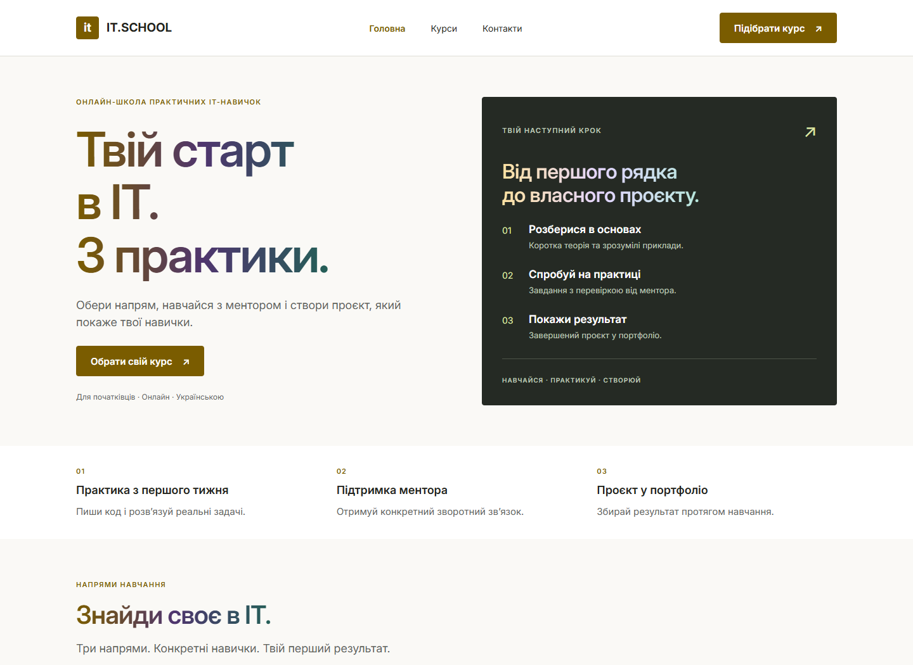
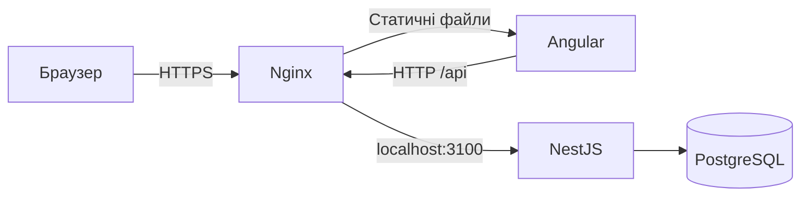

# IT.SCHOOL

Адаптивний сайт ІТ-школи на **Angular + NestJS + PostgreSQL**. Відвідувач обирає курс і залишає заявку; команда опрацьовує її в захищеній адмінпанелі. Стиль — **функціоналізм**, базовий колір — **#7A5C00**.

[](https://github.com/andriispeed/it-school/actions/workflows/it-school.yml)

**[Відкрити сайт](https://telegrambot.vps.webdock.cloud/it-school/)** · [Панель команди](https://telegrambot.vps.webdock.cloud/it-school/admin) · [Swagger API](https://telegrambot.vps.webdock.cloud/it-school/api/docs/) · [Порівняння CR15](https://telegrambot.vps.webdock.cloud/it-school/design)



## Можливості

- Чотири основні сторінки: головна, каталог, програма курсу та контакти з формою запису.
- Каталог із пошуком за назвою або технологією, фільтрами напрямів і сортуванням за ціною.
- Reactive Forms: перевірка полів, згода, стан надсилання та квитанція після збереження на сервері.
- Адмінпанель: пошук і пагінація заявок, статуси, видалення з підтвердженням, редагування курсів та історія дій.
- Серверні сесії, HttpOnly cookie, CSRF, перевірка Origin, DTO та обмеження частоти запитів.
- Адаптивність Desktop / Tablet / Mobile: каталог перебудовується **3 → 2 → 1**.
- Публікація через HTTPS, Docker Compose, healthchecks, резервні копії та перевірки в GitHub Actions.

Це навчальний проєкт. Заявки справді зберігаються в PostgreSQL; оплати, автоматичних листів і навчального кабінету студента немає. Для демонстрації використовуйте вигадані дані.

## Технології та архітектура

| Частина | Реалізація |
|---|---|
| Інтерфейс | Angular 20.3, TypeScript, standalone components, Router, signals, Reactive Forms |
| Стилі | SCSS, CSS Grid, Flexbox, CSS-змінні та статичний градієнт |
| API | NestJS 11, DTO, guards, Swagger |
| Дані | PostgreSQL 17, драйвер pg, параметризований SQL і транзакції |
| Сервер | Nginx, HTTPS, Docker Compose, systemd backup timer |
| Перевірки | TypeScript/Angular build, API integration tests, Playwright, GitHub Actions |



Nginx віддає сайт за `/it-school/`, API — за `/it-school/api/`. База не має публічного порту. Повторне надсилання заявки з тим самим `requestId` не створює другий запис; редагування курсу перевіряє його поточну версію.

## Структура репозиторію

```text
it-school/
├── frontend/       # Angular-сторінки, компоненти, стилі та локальні assets
├── backend/        # NestJS API, PostgreSQL, міграція та інтеграційні тести
├── config/         # tokens.json — джерело кольорів і градієнта
├── infra/          # Docker, Nginx, розгортання та резервні копії
├── scripts/        # генерація токенів, пакування, deploy та E2E
├── docs/           # технічна документація, ролі й матеріали захисту
└── .github/        # автоматичні перевірки
```

Усі команди нижче виконуються з кореня цього репозиторію, якщо не вказано інше. Шрифт Inter і його ліцензія знаходяться в `frontend/public/assets/`.

## Запуск локально

Потрібні **Node.js 24**, npm та **PostgreSQL 17**. Для бази можна використати Docker.

```powershell
git clone https://github.com/andriispeed/it-school.git
cd it-school
npm ci
npm run tokens
Copy-Item backend/.env.example backend/.env
```

У `backend/.env` встановіть власні `DB_PASSWORD` і `ADMIN_INITIAL_PASSWORD` (щонайменше 16 символів). Залиште `DB_HOST=127.0.0.1`, `DB_NAME=it_school`, `DB_USER=it_school`, `PUBLIC_URL=http://localhost:4200/it-school/` і `COOKIE_SECURE=false` для локального HTTP.

Якщо локальної PostgreSQL немає, після заповнення `.env` запустіть базу:

```powershell
docker compose --env-file backend/.env -f infra/compose.local.yaml up -d --wait
```

Або створіть базу `it_school` і користувача `it_school` у своїй PostgreSQL із паролем з `.env`. Якщо порт 5432 зайнятий, змініть `DB_PORT` у `.env` — локальний Compose враховує це значення.

```powershell
npm run build --workspace backend
npm run start:api
```

В іншому терміналі:

```powershell
npm start
```

Відкрийте **http://localhost:4200/it-school/**. Angular dev server проксіює запити до локального API на порту 3100. Міграція, три курси та початковий адміністратор створюються при першому запуску; повторний запуск не перезаписує їх.

## Команда

| Учасник | Відповідальність |
|---|---|
| **Шкіндер Андрій** | Бекенд, PostgreSQL, сервер, розгортання, адмінпанель і взаємодія з API |
| **Карпець Олександр** | Angular-сторінки, маршрутизація, компоненти та каталог |
| **Хомяк Дар’я** | Адаптивна верстка, SCSS, стилі та градієнти CSS |
| **Арсеній Липський** | Форма запису, клієнтська валідація, помилки й підтвердження |

[Карта відповідальності за файлами](docs/TEAM_ROLES.md) · [Окремі пам’ятки учасників](docs/defense/README.md)

## Рішення щодо CR15

Замовник запропонував триколірний градієнт для всього основного тексту. Команда обрала **часткове врахування**: градієнт **#7A5C00 → #4F356E → #245F57** застосований до великих заголовків і назв курсів. Абзаци, ціни, навігація та форма зберігають суцільний колір.

Таке оформлення підтримує візуальну ієрархію функціоналістичного сайту. На сторінці [CR15](https://telegrambot.vps.webdock.cloud/it-school/design) можна порівняти початковий варіант, повну вимогу та компроміс. [Обґрунтування, контраст і межі висновків](docs/CHANGE_REQUEST.md).

## Збірка та перевірки

```powershell
npm run build
npm audit --omit=dev --audit-level=high
```

`npm run build` генерує CSS-змінні з `config/tokens.json`, компілює NestJS і збирає Angular. CI виконує ці перевірки та запускає `backend/test/api.mjs` на окремій тестовій PostgreSQL. Тест відмовиться працювати з БД, назва якої не закінчується `_test`.

Для повної перевірки опублікованого сайту є `npm run verify`. Вона потребує Microsoft Edge і локального `.private/admin-access.json`, створює власні тестові заявки та тимчасово змінює курс, після чого прибирає тестові записи й відновлює ціну. [Опис перевірок](docs/TESTING.md).

## Розгортання

На VPS потрібні Docker Compose, Python 3.12+, Nginx і HTTPS-сертифікат. [Підготовка сервера та експлуатація](docs/OPERATIONS.md).

```powershell
npm ci
npm run build
npm run package
.\scripts\deploy.ps1 -Remote '<user@host>' -SshKey '<шлях до SSH-ключа>'
```

Скрипт завантажує окремий реліз, створює backup перед оновленням, запускає API та базу, перевіряє health endpoint і Nginx та перемикає поточну версію. При помилці повертає попередні код і конфігурацію. Дані й міграції автоматично назад не відкочуються.

Файли `.env`, приватні ключі, облікові дані, дампи БД, `node_modules`, зібрані релізи та локальні QA-звіти виключені з Git. У репозиторії є лише приклади змінних оточення без робочих секретів. GitHub Actions не має SSH-ключа й не виконує автоматичне розгортання.

## Документація та захист

| Документ | Зміст |
|---|---|
| [PROJECT_GUIDE](docs/PROJECT_GUIDE.md) | Повний технічний опис: сторінки, шлях заявки, база, API |
| [ARCHITECTURE](docs/ARCHITECTURE.md) | Компоненти системи та взаємодія |
| [OPERATIONS](docs/OPERATIONS.md) | Сервер, оновлення, backup і відкат |
| [TESTING](docs/TESTING.md) | Сценарії та результати перевірок |
| [TEAM_ROLES](docs/TEAM_ROLES.md) | Ролі та відповідні файли |
| [DEFENSE](docs/DEFENSE.md) | Сценарій до 10 хвилин для чотирьох осіб |
| [Особисті пам’ятки](docs/defense/README.md) | Пояснення функцій, текст виступу, демонстрація та запитання |

## Change Log

- **20.11.2026:** окремий репозиторій сайту; автономна збірка, конфігурація токенів, CI та оновлена документація.
- **19.11.2026:** чотири учасники з узгодженими ролями, докладні пам’ятки й сценарій захисту до 10 хвилин; вилучено публічний перегляд макетів.
- **18.11.2026:** Angular + NestJS + PostgreSQL, серверні заявки, адмінпанель, HTTPS, резервні копії; CR15 реалізовано як градієнт заголовків.
