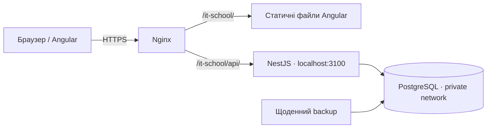

# Сервер та експлуатація

Публічна адреса: **https://telegrambot.vps.webdock.cloud/it-school/**.

## Схема



- Ubuntu 24.04, 1 vCPU, приблизно 1,6 GiB RAM.
- Окремий Compose-проєкт `it-school`: `api` і `db`.
- API: порт **127.0.0.1:3100**, пам’ять до 256 MiB. PostgreSQL: порт назовні не публікується, до 256 MiB, пул API до 5 з’єднань.
- `/opt/it-school/releases/` — версії; `/opt/it-school/current` — чинна.
- `/var/www/it-school` — посилання на frontend чинної версії.
- `/opt/it-school/runtime.env` та `admin-access.json` — приватні файли root, режим 600.
- `/etc/nginx/snippets/it-school.conf` — окремий include усередині наявного HTTPS virtual host.
- `/etc/nginx/sites-enabled/it-school` — активний віртуальний хост; зразок конфігурації — `infra/nginx-site.conf`.
- Наявний сертифікат використовується для того самого домену.

## Підготовка нового сервера

Потрібні Docker із Compose v2, Python 3.12+, Nginx, HTTPS-сертифікат для домену та SSH-доступ із можливістю `sudo`. У цьому розгортанні каталог завантаження — `/home/admin/it-school-upload`, робочий каталог — `/opt/it-school`.

1. Налаштувати DNS і сертифікат домену. Якщо домен відрізняється, узгодити `server_name`, шляхи сертифікатів, `PUBLIC_URL` і URL перевірки в `deploy.py`.
2. Встановити `infra/nginx-location.conf` як `/etc/nginx/snippets/it-school.conf`.
3. Встановити `infra/nginx-site.conf` як `/etc/nginx/sites-available/it-school`, увімкнути символічне посилання `/etc/nginx/sites-enabled/it-school`. Порт 80 має лише один `default_server`; перевірити конфігурацію через `sudo nginx -t` перед reload.
4. На комп’ютері виконати `npm ci`, `npm run build`, `npm run package`.
5. Запустити `scripts/deploy.ps1 -Remote <user@host> -SshKey <шлях>`. Скрипт створить runtime-конфігурацію й початковий доступ при першому розгортанні. Сервер отримує зібрані файли; компіляція Angular на VPS не потрібна.

При повторному розгортанні використовуються наявна БД та runtime-конфігурація. Скрипт перевіряє, що HTTPS virtual host містить include `/etc/nginx/snippets/it-school.conf`, і відмовляється змінювати невідому конфігурацію.

## Стан і логи

Після SSH-підключення:

```bash
sudo docker compose --project-name it-school --env-file /opt/it-school/runtime.env -f /opt/it-school/current/compose.yaml ps
sudo docker compose --project-name it-school --env-file /opt/it-school/runtime.env -f /opt/it-school/current/compose.yaml logs --tail=50 api
curl -f https://telegrambot.vps.webdock.cloud/it-school/api/health
```

Жодна команда для демонстрації не потребує показу `.env`, cookie або приватного ключа.

## Резервні копії

```bash
sudo systemctl status it-school-backup.timer
sudo systemctl start it-school-backup.service
sudo systemctl list-timers it-school-backup.timer
```

Щоденний таймер запускає `pg_dump -Fc` о 03:20 UTC з випадковою затримкою до 5 хвилин. Копії зберігаються в `/opt/it-school/backups/`; залишаються останні 14 успішних датованих копій. Перед оновленням також створюється dump. Поточна контрольна копія додатково завантажена на комп’ютер у `.private/backups/`.

Резервні копії містять дані заявок; не додавай їх у публічний Git. Постійне автоматичне копіювання поза VPS ще не налаштоване. Одна локальна копія не є географічно розподіленим backup-сервісом.

Перевірка відновлення виконується в окрему тимчасову БД `it_school_restore_check`, без перезапису чинної. Після порівняння кількості курсів/заявок тимчасова база видаляється. Для реального аварійного відновлення потрібні зупинка запису, вибір перевіреної копії та явне рішення, які дані відновлювати.

## Відкат коду

`deployment.json` містить поточну та попередню версію. Скрипт розгортання сам повертає попередній код при помилці healthcheck або Nginx. Успішне оновлення не видаляє попередні release-папки.

Автоматичного руйнівного відкату схеми БД немає. Перед новими несумісними міграціями потрібно спланувати збереження й відновлення даних.

## Доступ адміністратора

Пароль виданий у локальному `.private/admin-access.json`, який виключений із Git. Сервер зберігає пароль адміністратора у БД як scrypt-хеш; початкова копія доступу зберігається лише у приватному файлі root. Публічної реєстрації адміністратора немає.

Адмінпанель дозволяє видаляти конкретні заявки після підтвердження. Це видаляє їхні контактні дані з робочої БД; старі backups можуть містити ці дані до завершення строку ротації.
